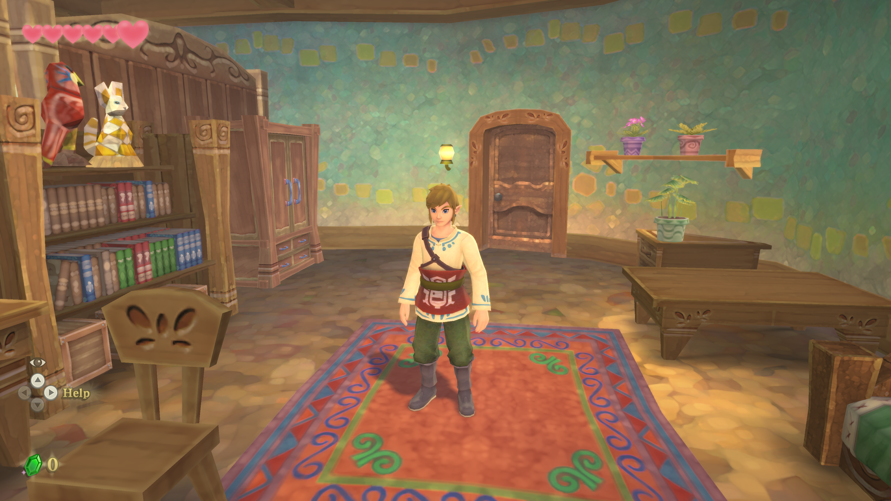

# Sky Recomp - Native PC Recompilation

**Sky Recomp** is a native PC port (Windows x86-64 with Vulkan) based on static AArch64 -> C recompilation of *The Legend of Zelda: Skyward Sword HD*.

> [!IMPORTANT]
> No game files are included. Sky Recomp needs your own legally obtained copy of the extracted game files of Skyward Sword v1.0.0, with no updates applied. When setting up, choose a folder that contains the exefs and romfs folders, or their contents. Instructions on how to obtain these files will NOT be provided!
> This project consists exclusively of the open-source static recompiler tooling and the Vulkan/SDL3 compatibility runtime.



---

##  Port Features

- **Native C/C++ Execution**: This is NOT an emulator (no JIT or dynamic interpretation). Guest AArch64 (ARM64) machine instructions are statically decompiled and lifted to native C code (`-march=x86-64-v3` with AVX2 and FMA).
- **Vulkan 1.3/1.4 Graphics Backend**: Nintendo Switch NVN (Nvidia Maxwell Tegra) API calls and shaders are translated directly into high-performance Vulkan pipelines for NVIDIA, AMD, and Intel GPUs.
- **1:1 Virtual Memory Layout**: The runtime reserves a 12.5 GB window at `0x7000000000` matching the 39-bit guest address space, enabling pointer operations with zero address-translation overhead.
- **SDL3 Input & Controller Support**: Seamless support for modern gamepads (Xbox, DualSense/DualShock, Nintendo Pro Controller) and keyboard/mouse. Includes standard button-controls mapping (right stick sword combat).
- **Solid 60 FPS Performance**: Harnesses modern multi-core CPUs and dedicated desktop GPUs for rock-solid 60.0 FPS gameplay at native resolutions (1080p, 1440p, 4K, and Ultrawide).
- **Embedded Setup GUI**: No batch scripts or command-line steps required. The standalone launcher GUI allows picking your ROM and keys on first launch and boots directly to PLAY on subsequent launches.

---

##  Getting Started

### System Requirements
- **Operating System**: Windows 10/11 64-bit
- **Processor**: x86-64 CPU with AVX2 support (Intel Haswell / 4th Gen Core or newer, AMD Ryzen or newer)
- **Graphics Card**: Vulkan 1.3+ compatible GPU (NVIDIA GeForce 900 series+, AMD Radeon RX 400+, Intel Arc / Iris Xe)
- **RAM**: 8 GB minimum (16 GB recommended)
- **Storage**: ~15 GB free space for extracted game assets

### How to Play (Release Package)
1. Download the release `.zip` package and extract it to a folder.
2. Double-click `skyrecomp.exe`.
3. On the Setup screen:
   - Click **Nintendo Switch ROM** and select your `.nsp` or `.xci` file.
4. Click **Play**.
   - The launcher will  the run in ~15 seconds and launch the game automatically.
5. On subsequent runs, `skyrecomp.exe` opens directly with the **PLAY** button.

### Developer Setup (Compiling from Source)
If you wish to build or modify the runtime from source:
1. Ensure **MSYS2 UCRT64** with `clang`, `lld`, and `make` is installed.
2. Ensure **Python 3.10+** with `cryptography` is installed (`pip install cryptography`).
3. Compile the launcher runtime:
   ```bash
   make skyrecomp.exe
   ```
4. Extract game files and compile the game library:
   ```bash
   python extract_nsp.py "<path_to_nsp>" "<path_to_keys>"
   python build_game.py
   ```

---

## Credits

This repository includes or depends on open-source components that must be credited under their respective licenses:

- **Dear ImGui** — MIT License  
  Source: `third_party/imgui`  
  License: `third_party/imgui/LICENSE.txt`
- **SMAA** — MIT-style license  
  Source: `third_party/smaa`  
  License: `third_party/smaa/LICENSE.txt`
- **Baloo 2 Font** — SIL Open Font License 1.1  
  License text: `Baloo2-OFL.txt`
- **SDL3**, **FFmpeg (LGPL builds)**, **Vulkan loader**, and related runtime libraries are used by build/runtime pipelines; licensing obligations remain with their original projects and distributors.

___

##  Legal Notice

This project is an independent open-source recreation created for educational and interoperability purposes. It is not affiliated with, endorsed by, or sponsored by Nintendo. *The Legend of Zelda* and *The Legend of Zelda: Skyward Sword* are registered trademarks of Nintendo. No copyrighted material or proprietary game assets are hosted or distributed in this repository.
